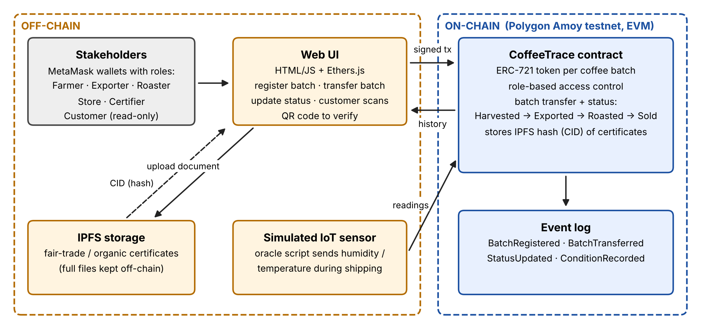
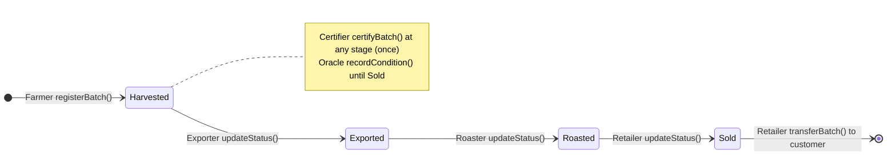

# CoffeeTrace: Blockchain-Based Coffee Supply Chain Provenance

**CSE 540: Engineering Blockchain Applications (Fall B 2026), Team 28**
Abdullah Alshahrani · Maharshi Saragadam · Mohammed Saeed M Alghamdi · Varshini Muniswaran

> **Status: Smart Contract Design (Nov 1, 2026).** The contract, its interface, automated tests
> and a deploy script are in place; the contract compiles with no warnings and all 15 tests pass.
> The web UI, IPFS upload and IoT simulator script come in the next milestones (see [Roadmap](#7-roadmap)).

---

## 1. Project Description

Specialty coffee sells at a premium because of claims about **where and how it was grown**
(single origin, fair trade, organic). Between the farm and the cup, a coffee lot passes through
several independent companies, and none of them controls a shared, trusted record, so origin
fraud is easy and hard to detect.

**CoffeeTrace** records each coffee batch on a public blockchain, so its history cannot be
quietly changed:

- Each batch is an **ERC-721 token** with a unique ID and an owner.
- Each stakeholder has a **role**. Only the current owner can move a batch, and only to the
  next stakeholder in the chain.
- **Fair-trade / organic certificates** are stored on **IPFS**; only their hash (CID) is kept
  on-chain, so any change to the file can be detected.
- A **simulated IoT sensor** records temperature and humidity during shipping.
- Each batch stores the farm's **GPS coordinates** (required by the EU Deforestation Regulation).
- Every action emits an **event**, which gives a permanent, public history. Customers can view it
  by scanning a QR code.



### Product journey

Each arrow is one transaction. Custody moves with `transferBatch`; the new holder then moves the
status forward with `updateStatus`.



---

## 2. Repository Structure

```
.
├── contracts/
│   ├── CoffeeTrace.sol             # main contract: ERC-721 + role-based access control
│   └── interfaces/
│       └── ICoffeeTrace.sol        # interface: data types, events, errors, function signatures
├── docs/
│   └── architecture.png            # system architecture (Fig. 1 of the proposal)
├── frontend/                       # web UI (planned: HTML/JS + Ethers.js + MetaMask)
├── scripts/
│   └── deploy.js                   # deploys CoffeeTrace, prints address + role IDs
├── test/
│   └── CoffeeTrace.test.js         # full journey + every safety rule (15 tests)
├── .env.example                    # Amoy RPC URL + deployer key template
├── hardhat.config.js               # compiler, Amoy network, gas reporter
├── LICENSE                         # MIT
└── package.json
```

---

## 3. Smart Contract Design

### How the contract matches the proposal

| Proposal design (Fig. 1) | Where it is in the code |
|---|---|
| One ERC-721 token per coffee batch, unique ID | `registerBatch` mints token ID = batch ID (starts at 1) |
| Stakeholders: farmer, exporter, roaster, store, certifier, customer | `FARMER_ROLE` … `CERTIFIER_ROLE`; customer needs no role |
| Status Harvested → Exported → Roasted → Sold | `Status` enum + `updateStatus` (forward one step only) |
| Custody transfer between stakeholders | `transferBatch` + `getCustodyHistory` |
| Certificates on IPFS, only the hash on-chain | `certifyBatch(batchId, certificateCID)` |
| Simulated IoT sensor (temperature / humidity) | `ORACLE_ROLE` + `recordCondition` + `getConditionReadings` |
| Event log | `BatchRegistered`, `BatchTransferred`, `StatusUpdated`, `BatchCertified`, `ConditionRecorded` |
| Customer verifies by QR code | Public `getBatch`, `getCustodyHistory`, `getConditionReadings` |

### Roles

| Role | Who | Can do |
|---|---|---|
| `DEFAULT_ADMIN_ROLE` | Deployer (team admin) | Grant / revoke all roles below |
| `FARMER_ROLE` | Coffee farm / cooperative | Register new batches |
| `EXPORTER_ROLE` | Exporter | Receive from farmer, mark **Exported** |
| `ROASTER_ROLE` | Roaster | Receive from exporter, mark **Roasted** |
| `RETAILER_ROLE` | Store | Receive from roaster, mark **Sold**, hand over to customer |
| `CERTIFIER_ROLE` | Fair-trade / organic certifier | Certify a batch with an IPFS CID |
| `ORACLE_ROLE` | Simulated IoT sensor | Record temperature / humidity |
| *(none)* | Customer / public | Read any batch (view functions) |

### Functions

All signatures are declared in [`ICoffeeTrace.sol`](contracts/interfaces/ICoffeeTrace.sol), which
`CoffeeTrace` implements. The interface also holds the shared data types, events and errors, so the
web UI only needs the interface ABI.

| Function | Access | Description |
|---|---|---|
| `registerBatch(origin, geolocation, variety, weightKg, harvestDate) → batchId` | Farmer | Creates a batch and mints its ERC-721 token to the farmer |
| `transferBatch(batchId, to)` | Current owner | Hands the batch to the next stakeholder (recipient's role is checked) |
| `updateStatus(batchId, newStatus)` | Current owner with matching role | Moves the batch forward **one** stage |
| `certifyBatch(batchId, certificateCID)` | Certifier | Marks the batch certified and stores the IPFS CID |
| `recordCondition(batchId, temperatureX10, humidityX10)` | Oracle | Stores a sensor reading (e.g. `215` = 21.5 °C) |
| `getBatch(batchId)` | Anyone | Full batch record |
| `getCustodyHistory(batchId)` | Anyone | Every address that has held the batch, in order |
| `getConditionReadings(batchId)` | Anyone | All sensor readings |
| `totalBatches()` | Anyone | Number of registered batches |

### Events

`BatchRegistered` · `BatchTransferred` · `StatusUpdated` · `BatchCertified` · `ConditionRecorded`

### Safety rules enforced by the contract

- Status can only move **forward one step** (it can't skip from Harvested to Roasted or go backwards).
- A batch can only be transferred to an address with the **next role** in the chain.
- Standard ERC-721 `transferFrom` / `safeTransferFrom` are **blocked** (through OpenZeppelin's
  `_update` hook), so the role checks can't be bypassed.
- A batch can only be certified **once**; sensor readings are rejected after the batch is **Sold**.
- Custom errors (e.g. `NotBatchOwner`, `InvalidStatusTransition`) explain why a transaction failed.

Each of these rules has a test in [`test/CoffeeTrace.test.js`](test/CoffeeTrace.test.js).

---

## 4. Dependencies

| Tool | Purpose |
|---|---|
| [Solidity](https://docs.soliditylang.org) `0.8.24` | Smart contract language |
| [OpenZeppelin Contracts](https://docs.openzeppelin.com/contracts/5.x/) `5.x` | `ERC721`, `AccessControl` |
| [Node.js](https://nodejs.org) 18 or newer | Runs Hardhat |
| [Hardhat](https://hardhat.org) 2.22 + Hardhat Toolbox | Compile, test, gas report, deploy |
| [Remix IDE](https://remix.ethereum.org) | Alternative: compile and deploy in the browser |
| [MetaMask](https://metamask.io) | One wallet per stakeholder |
| Polygon **Amoy** testnet (chain ID 80002) + free **POL** test tokens | Deployment network |
| IPFS *(planned)* | Certificate storage |

---

## 5. How to Compile, Test and Deploy

### Option A: Hardhat (command line)

```bash
git clone https://github.com/MohaAtq/CoffeeTrace-CSE540.git
cd CoffeeTrace-CSE540
npm install

npx hardhat compile                 # compile contracts
npx hardhat test                    # run the 15 tests
REPORT_GAS=true npx hardhat test    # same, plus gas used per function
```

**Deploy locally**

```bash
npx hardhat node                    # terminal 1: local blockchain with 20 funded test accounts
npm run deploy:local                # terminal 2: deploys and prints the address and role IDs
```

**Deploy to Polygon Amoy**

1. `cp .env.example .env` and fill in `PRIVATE_KEY` with a **test wallet** that has Amoy POL
   from the Polygon faucet. Never commit `.env`.
2. `npm run deploy:amoy`
3. The deploying account is the admin. Grant roles with `grantRole(<role ID>, <address>)`.

### Option B: Remix + MetaMask (browser)

1. Install MetaMask, create **several accounts** (admin, farmer, exporter, roaster, retailer,
   certifier, oracle), add the **Polygon Amoy** network (e.g. through ChainList) and get free
   **POL** from the Polygon faucet for the admin account.
2. Open [Remix](https://remix.ethereum.org) and create `CoffeeTrace.sol` and
   `interfaces/ICoffeeTrace.sol` with the code from `contracts/`.
3. In **Solidity Compiler**, select **0.8.24 or newer**. Under *Advanced Configurations*, set the
   **EVM version to `cancun`** (OpenZeppelin 5.x requires it). Click **Compile CoffeeTrace.sol**;
   Remix downloads the OpenZeppelin imports automatically.
4. In **Deploy & Run Transactions**, choose **Injected Provider – MetaMask** (Amoy), select
   `CoffeeTrace` and click **Deploy**. For a quick test without MetaMask, choose
   **Remix VM (Cancun)** instead.

### Example workflow

```text
# 1) Admin grants roles (role IDs come from deploy.js or the FARMER_ROLE() getter, etc.)
grantRole(FARMER_ROLE,    <farmer address>)
grantRole(EXPORTER_ROLE,  <exporter address>)
grantRole(ROASTER_ROLE,   <roaster address>)
grantRole(RETAILER_ROLE,  <retailer address>)
grantRole(CERTIFIER_ROLE, <certifier address>)
grantRole(ORACLE_ROLE,    <oracle address>)

# 2) Farmer registers a batch  -> batchId = 1
registerBatch("Finca El Paraiso, Huila, Colombia", "2.1167,-75.8833", "Arabica", 500, 1761350400)

# 3) Batch moves along the chain (status values: 0 Harvested, 1 Exported, 2 Roasted, 3 Sold)
[farmer]    transferBatch(1, <exporter>)
[exporter]  updateStatus(1, 1)
[oracle]    recordCondition(1, 215, 605)             # 21.5 °C, 60.5 % humidity
[certifier] certifyBatch(1, "bafy...<IPFS CID>")
[exporter]  transferBatch(1, <roaster>)
[roaster]   updateStatus(1, 2)
[roaster]   transferBatch(1, <retailer>)
[retailer]  updateStatus(1, 3)
[retailer]  transferBatch(1, <customer>)

# 4) Anyone (customer) verifies the batch
getBatch(1) · getCustodyHistory(1) · getConditionReadings(1)
```

---

## 6. Early Gas Measurements

From `REPORT_GAS=true npx hardhat test` on the local Hardhat network (optimizer on, 200 runs).
These are averages over the test runs; the full gas analysis is part of the final report.

| Action | Average gas |
|---|---|
| Deploy `CoffeeTrace` | 2,528,568 |
| `registerBatch` | 289,333 |
| `recordCondition` | 112,806 |
| `transferBatch` | 90,765 |
| `certifyBatch` | 62,975 |
| `updateStatus` | 43,378 |

`registerBatch` costs the most because it stores the batch's text fields (origin, geolocation,
variety) on-chain and mints the token.

---

## 7. Roadmap

| Milestone | Date | Scope |
|---|---|---|
| ✅ Proposal + Team Contract | Oct 25 | System concept and architecture |
| ✅ **Smart Contract Design** | **Nov 1** | Contract, interface, tests, deploy script, README |
| ⏳ Interim Demo | Nov 15 | Deploy to Amoy, simple web UI, IPFS upload, end-to-end demo |
| ⏳ Final Project | Dec 4 | QR verification page, IoT oracle script, gas analysis, report |

**Stretch goals:** alerts when temperature/humidity go out of range; splitting one batch into
smaller retail bags; certificate revocation.

---

## 8. References

1. W. Entriken, D. Shirley, J. Evans, N. Sachs, *ERC-721: Non-Fungible Token Standard*, EIP-721, 2018.
2. OpenZeppelin Contracts 5.x documentation: ERC721 and AccessControl.
3. J. Benet, *IPFS: Content Addressed, Versioned, P2P File System*, arXiv:1407.3561, 2014.

## License

[MIT](LICENSE)
